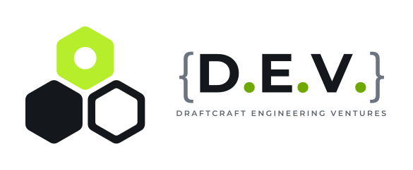
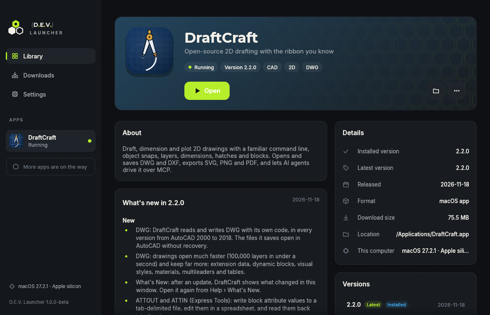
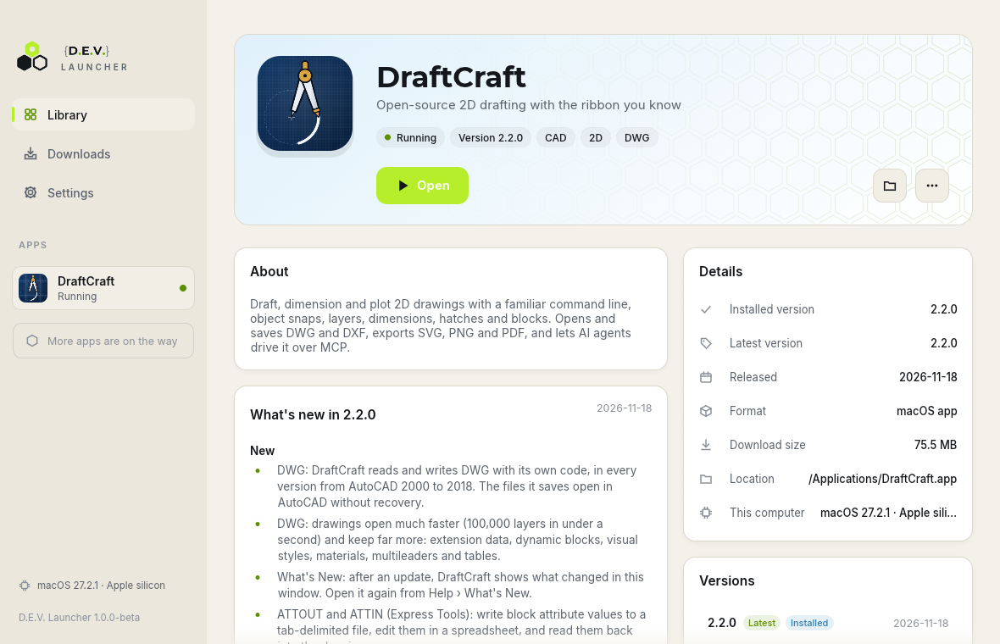
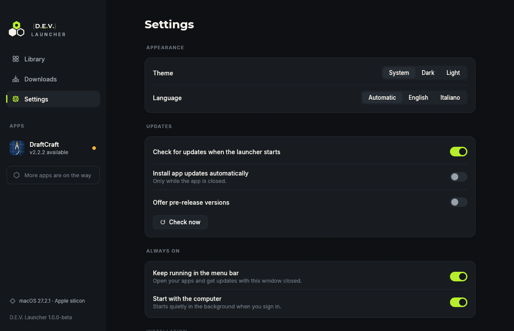
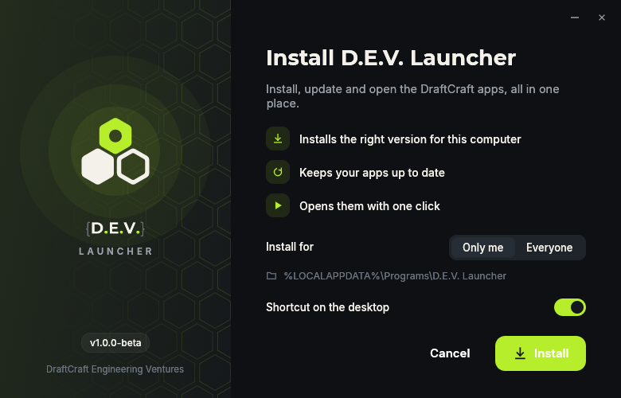
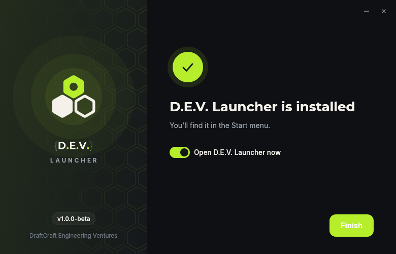
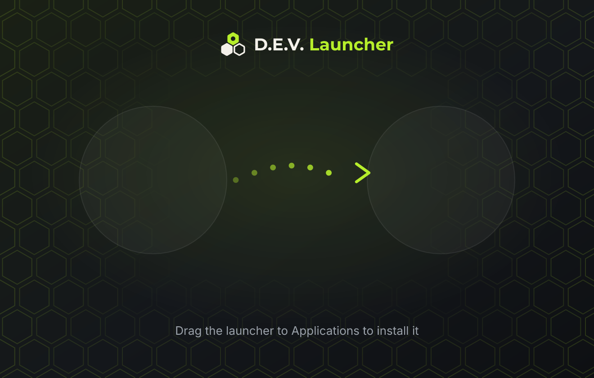
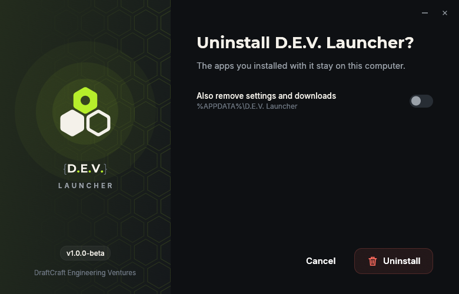

<p align="center">
  <picture>
    <source media="(prefers-color-scheme: dark)" srcset="assets/brand/dev-logo-dark.svg">
    
  </picture>
</p>

<h1 align="center">D.E.V. Launcher</h1>

<p align="center">
  <b>Install, update and open the DraftCraft apps, all in one place.</b>
</p>

<p align="center">
  The launcher of DraftCraft Engineering Ventures picks the right build for your computer
  (Windows, macOS or Linux, x86_64 or ARM64, Apple silicon or Intel) and does the whole install
  itself. It keeps your apps up to date, and from the menu bar or the notification area it opens
  any of them in one click.
</p>

<p align="center">
  <a href="https://github.com/DraftCraft-DEV/DEV-Launcher/releases/latest/download/dev-launcher-windows-x64-setup.exe"></a>
  <a href="https://github.com/DraftCraft-DEV/DEV-Launcher/releases/latest/download/dev-launcher-macos-universal.dmg"></a>
  <a href="https://github.com/DraftCraft-DEV/DEV-Launcher/releases/latest/download/dev-launcher-linux-x86_64.AppImage"></a>
</p>

<p align="center">
  <a href="https://draftcraft.dev"></a>
  <a href="https://discord.gg/YgRK8Eww9x"></a>
  <a href="https://ko-fi.com/K0O529L823"></a>
</p>

<p align="center">
  
  
  
  
  
</p>

<p align="center">
  <a href="#screenshots">Screenshots</a> ·
  <a href="#downloads">Downloads</a> ·
  <a href="#what-it-does">What it does</a> ·
  <a href="#always-at-hand">Always at hand</a> ·
  <a href="#build-from-source">Build from source</a> ·
  <a href="#found-a-bug">Found a bug?</a> ·
  <a href="#made-by">Made by</a> ·
  <a href="#license">License</a>
</p>

> [!NOTE]
> **This is a beta.** Today the launcher knows one app,
> [DraftCraft™](https://github.com/DraftCraft-DEV/DraftCraft), the open-source 2D drafting app; the other
> apps of DraftCraft Engineering Ventures will show up in it as they are released. It reads the list of
> apps from this repository, so new ones appear without updating the launcher.

<p align="center">
  
  <br><sub><b>The library</b>: each app with its version, what's new, where it is installed and every earlier release.</sub>
</p>

## Screenshots

<table>
  <tr>
    <td width="50%"></td>
    <td width="50%"></td>
  </tr>
  <tr>
    <td><sub><b>Light or dark</b>: it follows the system, or your choice; English or Italian.</sub></td>
    <td><sub><b>Settings</b>: automatic updates, pre-releases, the menu bar icon and where apps go.</sub></td>
  </tr>
  <tr>
    <td></td>
    <td></td>
  </tr>
  <tr>
    <td colspan="2"><sub><b>Its own installer</b> on Windows and Linux: no stock setup wizard, just the launcher installing itself.</sub></td>
  </tr>
  <tr>
    <td></td>
    <td></td>
  </tr>
  <tr>
    <td><sub><b>On macOS</b>, open the disk image and drag the launcher into Applications.</sub></td>
    <td><sub><b>Uninstalling</b> leaves the apps you installed with it where they are.</sub></td>
  </tr>
</table>

## Downloads

One click downloads the newest version from the [latest release](https://github.com/DraftCraft-DEV/DEV-Launcher/releases/latest):

| System | Download |
|---|---|
| Windows 10 and 11 | Setup: [64-bit (x64)](https://github.com/DraftCraft-DEV/DEV-Launcher/releases/latest/download/dev-launcher-windows-x64-setup.exe) · [ARM64](https://github.com/DraftCraft-DEV/DEV-Launcher/releases/latest/download/dev-launcher-windows-arm64-setup.exe) — portable zip: [x64](https://github.com/DraftCraft-DEV/DEV-Launcher/releases/latest/download/dev-launcher-windows-x64-portable.zip) · [ARM64](https://github.com/DraftCraft-DEV/DEV-Launcher/releases/latest/download/dev-launcher-windows-arm64-portable.zip) |
| macOS 11 or later | Disk image for Apple silicon and Intel: [dev-launcher-macos-universal.dmg](https://github.com/DraftCraft-DEV/DEV-Launcher/releases/latest/download/dev-launcher-macos-universal.dmg) |
| Linux (any distribution) | AppImage: [x86_64](https://github.com/DraftCraft-DEV/DEV-Launcher/releases/latest/download/dev-launcher-linux-x86_64.AppImage) · [ARM64 (aarch64)](https://github.com/DraftCraft-DEV/DEV-Launcher/releases/latest/download/dev-launcher-linux-aarch64.AppImage) |
| Debian, Ubuntu 22.04 or later | .deb: [x86_64](https://github.com/DraftCraft-DEV/DEV-Launcher/releases/latest/download/dev-launcher-linux-x86_64.deb) · [ARM64 (aarch64)](https://github.com/DraftCraft-DEV/DEV-Launcher/releases/latest/download/dev-launcher-linux-aarch64.deb) |
| Fedora, openSUSE, RHEL | .rpm: [x86_64](https://github.com/DraftCraft-DEV/DEV-Launcher/releases/latest/download/dev-launcher-linux-x86_64.rpm) · [ARM64 (aarch64)](https://github.com/DraftCraft-DEV/DEV-Launcher/releases/latest/download/dev-launcher-linux-aarch64.rpm) |
| Arch Linux, Manjaro, EndeavourOS | pacman package: [x86_64](https://github.com/DraftCraft-DEV/DEV-Launcher/releases/latest/download/dev-launcher-linux-x86_64.pkg.tar.zst) · [ARM64 (aarch64)](https://github.com/DraftCraft-DEV/DEV-Launcher/releases/latest/download/dev-launcher-linux-aarch64.pkg.tar.zst) — or `dev-launcher-bin` from the AUR |

The release page also has a plain `.tar.gz` for each Linux processor and `SHA256SUMS.txt`.

- **Windows** — run the setup (`dev-launcher-windows-x64-setup.exe`). It is the launcher itself, showing
  its own install screen: it installs for your account (or, if you choose, for everyone), adds D.E.V.
  Launcher to the Start menu and, if you want, to the desktop. Uninstall it from **Settings › Apps ›
  Installed apps**. The portable zip runs from any folder instead. Neither is signed yet, so SmartScreen
  may stop it the first time: choose **More info**, then **Run anyway**.
- **macOS** — open the disk image and drag **D.E.V. Launcher** into **Applications**. There is nothing
  else to install; to remove it, move it to the Trash. It isn't notarized yet, so the first time open it
  once, then **System Settings › Privacy & Security › Open Anyway** — or run
  `xattr -dr com.apple.quarantine "/Applications/D.E.V. Launcher.app"`.
- **Linux** — the AppImage installs itself too: make it executable (`chmod +x dev-launcher-linux-x86_64.AppImage`)
  and open it, and it offers to put itself in `~/Applications`, in the applications menu and on your
  `PATH` as `dev-launcher` (or to run without installing). Or install the package for your distribution:
  `sudo apt install ./dev-launcher-linux-x86_64.deb`, `sudo dnf install ./dev-launcher-linux-x86_64.rpm`,
  `sudo pacman -U dev-launcher-linux-x86_64.pkg.tar.zst`, or `yay -S dev-launcher-bin`. On ARM, take
  the `aarch64` file.

## What it does

- **Installs the right build.** It reads each app's GitHub releases and chooses the file for your
  system and processor: the right disk image on a Mac, the x64 or ARM64 setup on Windows, the AppImage
  or your distribution's own package (`.deb`, `.rpm`, Arch) on Linux.
- **Does the install itself.** On macOS it mounts the disk image and copies the app into Applications;
  on Windows it runs the app's setup silently; on Linux it puts the AppImage in place with a menu entry,
  or installs the package (asking for your password once). Every download is checked against the
  release's SHA-256 sums.
- **Keeps apps up to date.** It checks for new versions when it starts and every hour, shows what's new,
  and updates in one click — or on its own, while the app is closed. A running app keeps working and
  picks up the new version when you restart it.
- **Finds what's already there.** Copies you installed yourself are found too, and any earlier version
  can be installed again from the list of releases.

## Always at hand

D.E.V. Launcher starts with your computer and stays out of the way: closing the window leaves a small
icon in the **menu bar** on macOS, in the **notification area** on Windows and in the **system tray** on
Linux.

- Click it to see your installed apps and open any of them at once.
- It keeps checking for updates in the background: the icon gets a dot when one is ready, and the menu
  offers **Update to …** (or installs it for you, if automatic updates are on).
- **Open D.E.V. Launcher** brings the window back; **Quit D.E.V. Launcher** closes the icon until the
  next start.

Both are settings: **Keep running in the menu bar** and **Start with the computer**. On Linux the icon
uses the StatusNotifierItem standard of KDE, Xfce, Cinnamon and most desktops; on GNOME it needs the
AppIndicator extension (Ubuntu has it already).

## Build from source

You need [Rust](https://rustup.rs) 1.90 or later.

```sh
cargo run --release
cargo test
```

A few options help when working on it:

| Option | Does |
|---|---|
| `--screenshot out.png` | saves a picture of the window and quits (with `--page library\|downloads\|settings`, `--theme dark\|light`, `--lang en\|it`) |
| `--app <id>` | opens with that app selected |
| `--tray` | runs only the menu bar / tray icon |
| `--setup`, `--uninstall` | show the install and uninstall screens (Windows, Linux) |
| `--install [--everyone] [--desktop-shortcut]`, `--uninstall --quiet [--remove-data]` | install or uninstall without a window |

The apps it knows are listed in [`catalog.json`](catalog.json). Releases are built by
[`.github/workflows/release.yml`](.github/workflows/release.yml) when a `v*` tag matching `Cargo.toml` is
pushed.

## Found a bug?

Please [open an issue](https://github.com/DraftCraft-DEV/DEV-Launcher/issues/new) with what you did, what you
expected and what happened — a screenshot helps a lot. **Settings › Open log** shows the launcher's log file.
Or come and say it on [Discord](https://discord.gg/YgRK8Eww9x).

Pull requests are welcome too: fork the repository, make your change on a branch, run `cargo test`, and
[open a pull request](https://github.com/DraftCraft-DEV/DEV-Launcher/pulls).

## Made by

D.E.V. Launcher is made by **[DraftCraft Engineering Ventures](https://github.com/DraftCraft-DEV)**:
**[SkryxDev](https://github.com/SkryxDev)** and **[WithShalom Studios](https://github.com/withshalom)**,
the people behind [DraftCraft™](https://github.com/DraftCraft-DEV/DraftCraft). Find out more at
[draftcraft.dev](https://draftcraft.dev), and if you like what we make, you can
[support us on Ko-fi](https://ko-fi.com/K0O529L823).

## License

D.E.V. Launcher is licensed under the [Apache License 2.0](LICENSE). The bundled Inter and Montserrat fonts
keep their own SIL Open Font License ([`assets/fonts`](assets/fonts)). DraftCraft™ and the DraftCraft logo
are trademarks of DraftCraft Engineering Ventures.
